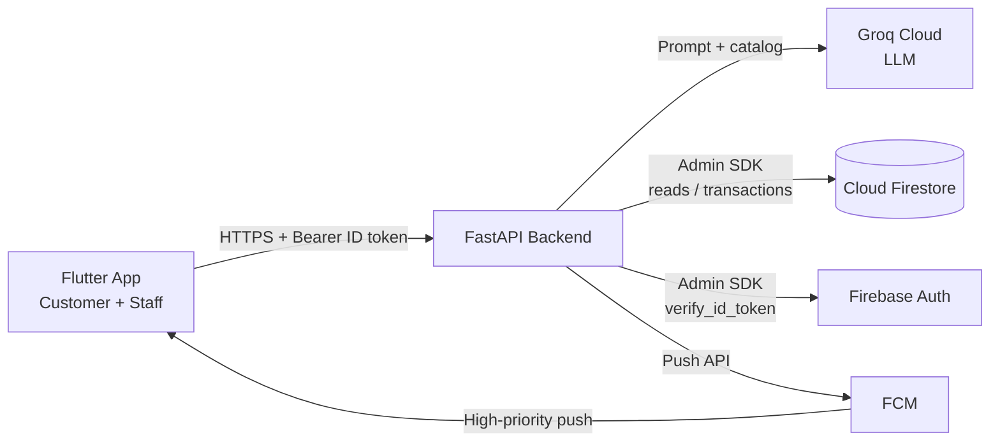
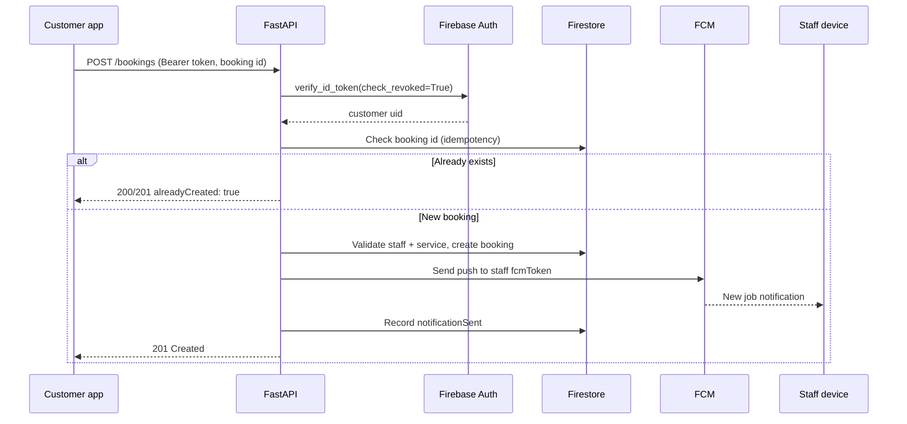

<div align="center">

# 🛠️ ServiceHub AI — Backend

**The intelligence layer behind ServiceHub AI: intent recognition, geospatial search, secure bookings and push notifications.**

<br/>

[](https://fastapi.tiangolo.com)
[](https://www.python.org)
[](https://firebase.google.com/docs/admin/setup)
[](https://firebase.google.com/docs/cloud-messaging)
[](https://groq.com)
[](https://docs.pydantic.dev)
[](LICENSE)

<br/>

📱 **Mobile app:** [service_hub_ai](https://github.com/amalmathew2003/service_hub_ai) (Flutter)

</div>

---

## 💡 What is it?

ServiceHub connects customers who need help *right now* (plumbers, electricians, AC technicians, cleaners, mechanics) with nearby verified professionals.

This backend sits between the **Flutter client**, **Cloud Firestore**, **Firebase Auth**, **FCM** and **Groq**, and does four jobs:

| Job | What it does |
|---|---|
| 🧠 **Understand** | Turns messages like *"water is leaking from my ceiling"* into a real service from your Firestore catalog |
| 📍 **Discover** | Finds online staff within a radius using Haversine distance |
| 🔐 **Transact** | Verifies Firebase ID tokens, blocks role abuse, creates bookings idempotently |
| 🔔 **Notify** | Sends high-priority FCM pushes to staff devices when a job arrives |

> 🛡️ **Integrity rule:** the LLM only interprets language. Staff, availability, distances and bookings always come from Firestore, never from the model.

---

## 📑 Table of Contents

- [Features](#-features)
- [Architecture](#️-architecture)
- [Quickstart](#-quickstart)
- [Environment Variables](#-environment-variables)
- [API Reference](#-api-reference)
- [Firestore Schema](#️-firestore-schema)
- [Project Structure](#-project-structure)
- [Security](#️-security)
- [Troubleshooting](#-troubleshooting)
- [Related Repositories](#-related-repositories)
- [Contributing](#-contributing)
- [License](#-license)

---

## ✨ Features

| Feature | Endpoint | Notes |
|---|---|---|
| Conversational assistant | `POST /chat` | Guides users toward the right type of service |
| Service identification | `POST /identify-service` | Groq classification with algorithmic fallback, matched against live Firestore services |
| Staff service suggestions | `POST /staff/service-suggestions` | Helps staff build their catalog during onboarding |
| Nearby staff search | `GET /staff/search` | Haversine filter, online staff only, returns distance in km |
| Idempotent booking | `POST /bookings` | Auth-verified, retry-safe, triggers push notification |
| FCM diagnostics | `POST /notifications/test` | Verifies push delivery to the caller's device |
| Unmet-demand registry | `POST /service-requests` | Captures services users want but the platform lacks |
| Health checks | `GET /health` and others | Liveness and Firestore connectivity |

---

## 🏗️ Architecture



### Booking flow



---

## 🚀 Quickstart

### Prerequisites

- **Python 3.10+**
- A **Firebase project** with Firestore, Authentication and Cloud Messaging enabled
- A **Groq API key** from [console.groq.com](https://console.groq.com/)

### 1. Clone

```bash
git clone https://github.com/amalmathew2003/service_hub_backend.git
cd service_hub_backend
```

### 2. Create a virtual environment

```bash
# Windows (PowerShell)
python -m venv venv
.\venv\Scripts\Activate.ps1

# macOS / Linux
python3 -m venv venv
source venv/bin/activate
```

### 3. Install dependencies

```bash
pip install fastapi "uvicorn[standard]" firebase-admin groq python-dotenv pydantic
```

> 💡 Tip: run `pip freeze > requirements.txt` once and commit it, so others can simply run `pip install -r requirements.txt`.

### 4. Add credentials

1. **Firebase Admin key:** Firebase Console → Project Settings → Service Accounts → *Generate new private key*. Save it as `serviceAccountKey.json` in the project root.
2. **Environment file:** create `.env` in the project root:

```env
GROQ_API_KEY=gsk_your_groq_api_key_here
GROQ_MODEL=openai/gpt-oss-20b
```

### 5. Run

```bash
uvicorn main_updated:app --reload --host 0.0.0.0 --port 8000
```

Open the interactive docs:

- Swagger UI → <http://127.0.0.1:8000/docs>
- ReDoc → <http://127.0.0.1:8000/redoc>

### 6. Connect the mobile app

```bash
flutter run --dart-define=API_BASE_URL=http://<YOUR_LAN_IP>:8000
```

| Where the app runs | Base URL |
|---|---|
| Android emulator | `http://10.0.2.2:8000` |
| iOS simulator | `http://localhost:8000` |
| Physical device (same Wi-Fi) | `http://<your-computer-LAN-IP>:8000` |

---

## 🔐 Environment Variables

| Variable | Required | Default | Description |
|---|---|---|---|
| `GROQ_API_KEY` | ✅ Yes | — | Groq API key |
| `GROQ_MODEL` | No | `openai/gpt-oss-20b` | Groq model identifier |

Files you must keep **out of Git**: `.env` and `serviceAccountKey.json`.

---

## 📡 API Reference

### Authentication

Protected endpoints expect a Firebase ID token:

```http
Authorization: Bearer <FIREBASE_ID_TOKEN>
```

Tokens are verified server-side with `firebase_admin.auth.verify_id_token(token, check_revoked=True)`.

### Endpoint overview

| Method | Path | Auth | Purpose |
|---|---|:---:|---|
| `POST` | `/chat` | No | General assistant reply |
| `POST` | `/identify-service` | No | Map a message to a catalog service |
| `GET` | `/staff/search` | No | Find nearby online staff |
| `POST` | `/staff/service-suggestions` | No | AI service-name suggestions |
| `POST` | `/bookings` | ✅ Customer | Create a booking and notify staff |
| `POST` | `/notifications/test` | ✅ Staff | Send a test push to own device |
| `POST` | `/service-requests` | No | Request an unlisted service |
| `GET` | `/`, `/health`, `/firebase-test`, `/firebase-users-test` | No | Status and diagnostics |

<details>
<summary><b>POST /chat</b></summary>

Request:

```json
{ "message": "My kitchen tap is dripping continuously. Who can fix it?" }
```

Response `200`:

```json
{ "reply": "It looks like you have a plumbing leak. I recommend booking a certified Plumber to replace the washer or repair the pipe valve." }
```

</details>

<details>
<summary><b>POST /identify-service</b></summary>

Maps free text to a service that exists in Firestore.

Request:

```json
{ "message": "I need my split air conditioner cleaned and serviced before summer." }
```

Response `200`:

```json
{
  "reply": "I found a matching service: AC Cleaning. Would you like to proceed?",
  "service_name": "AC Cleaning",
  "requires_confirmation": false
}
```

</details>

<details>
<summary><b>GET /staff/search</b></summary>

| Parameter | Type | Required | Description |
|---|---|:---:|---|
| `latitude` | float | ✅ | Customer latitude, e.g. `9.9312` |
| `longitude` | float | ✅ | Customer longitude, e.g. `76.2673` |
| `service_name` | string | No | Filter by service, e.g. `Plumbing` |
| `radius_km` | float | No | Search radius in km (default `15.0`) |

Request:

```http
GET /staff/search?latitude=9.9816&longitude=76.2999&service_name=AC%20Cleaning&radius_km=10
```

Response `200`:

```json
{
  "count": 1,
  "service_name": "AC Cleaning",
  "radius_km": 10.0,
  "staff": [
    {
      "staff_id": "u4JkL992aP",
      "name": "Alex Thomas",
      "location_name": "Kaloor, Kochi",
      "profile_image": "https://storage.googleapis.com/...",
      "latitude": 9.9890,
      "longitude": 76.3050,
      "distance_km": 0.98,
      "services": [
        {
          "service_id": "srv_ac_01",
          "name": "AC Cleaning",
          "description": "Deep chemical foam washing and coil cleaning"
        }
      ]
    }
  ]
}
```

</details>

<details>
<summary><b>POST /staff/service-suggestions</b></summary>

Request:

```json
{ "service_text": "air conditioner" }
```

Response `200`:

```json
{
  "query": "air conditioner",
  "source": "groq",
  "suggestions": [
    "AC Mechanic",
    "AC Cleaning",
    "AC Installation",
    "AC Gas Refilling",
    "AC Water Leakage Repair"
  ]
}
```

</details>

<details>
<summary><b>POST /bookings</b> 🔒</summary>

Creates the booking atomically and pushes a notification to the staff member.

Headers: `Authorization: Bearer <CUSTOMER_FIREBASE_ID_TOKEN>`

Request:

```json
{
  "id": "book_981240182",
  "staffId": "staff_uid_456",
  "serviceId": "srv_plumb_01",
  "scheduledDate": "2026-10-25T10:30:00Z",
  "staffLatitude": 9.9890,
  "staffLongitude": 76.3050
}
```

Response `201`:

```json
{
  "success": true,
  "bookingId": "book_981240182",
  "notificationSent": true,
  "alreadyCreated": false,
  "message": "Booking created successfully."
}
```

**Idempotency:** if the client retries with the same `id` after a network drop, no duplicate is created and the response returns `alreadyCreated: true`.

</details>

<details>
<summary><b>POST /notifications/test</b> 🔒</summary>

Headers: `Authorization: Bearer <STAFF_FIREBASE_ID_TOKEN>`

Response `200`:

```json
{
  "success": true,
  "messageId": "projects/servicehub/messages/0:1697...",
  "message": "Firebase accepted the test notification for delivery."
}
```

Supports Android high-priority channels and Apple APNs sound payloads.

</details>

<details>
<summary><b>POST /service-requests</b></summary>

Request:

```json
{
  "requested_service": "Solar Panel Pressure Washing",
  "description": "Need rooftop solar panels cleaned of moss and dust"
}
```

Response `201`:

```json
{
  "success": true,
  "request_id": "req_88a9df21",
  "requested_service": "Solar Panel Pressure Washing",
  "status": "pending",
  "message": "Thank you for your suggestion! We've recorded your request for future review."
}
```

</details>

<details>
<summary><b>Health and diagnostics</b></summary>

| Method | Path | Description |
|---|---|---|
| `GET` | `/` | Root status message |
| `GET` | `/health` | Liveness probe → `{"status": "healthy"}` |
| `GET` | `/firebase-test` | Checks Firestore connectivity and lists root collections |
| `GET` | `/firebase-users-test` | Shows the first 5 documents in `users` |

⚠️ The two `firebase-*` diagnostic routes expose data. Disable or protect them in production.

</details>

---

## 🗄️ Firestore Schema

```
Firestore
├── users/{userId}
│   ├── role: "customer" | "staff"
│   ├── name, email
│   ├── fcmToken
│   ├── isOnline            (staff only)
│   ├── latitude, longitude
│   ├── locationName
│   └── services/{serviceId}   (sub-collection, staff only)
│       ├── id, name
│       └── description
│
├── bookings/{bookingId}
│   ├── id
│   ├── customerId, customerName
│   ├── staffId, staffName
│   ├── serviceId, serviceName
│   ├── status: "pending" | "accepted" | "in_progress" | "completed" | "cancelled"
│   ├── scheduledDate: timestamp | null
│   ├── customerLatitude, customerLongitude
│   ├── staffLatitude, staffLongitude
│   ├── notificationSent: boolean
│   └── createdAt, updatedAt: server timestamps
│
└── service_requests/{requestId}
    ├── requested_service
    ├── description
    ├── status: "pending"
    └── created_at: server timestamp
```

---

## 📁 Project Structure

```
service_hub_backend/
├── main_updated.py          # Production FastAPI app (run this one)
├── main.py                  # Earlier core routes
├── serviceAccountKey.json   # Firebase Admin credentials (never commit)
├── .env                     # Secrets and config (never commit)
├── .gitignore
└── README.md
```

> 💡 Having both `main.py` and `main_updated.py` can confuse contributors. Consider renaming `main_updated.py` to `main.py` (and deleting the old one) so the run command becomes `uvicorn main:app`.

---

## 🛡️ Security

- **Server-side token verification:** user identity always comes from the verified ID token, never from IDs in the request body.
- **Role checks:** staff accounts cannot create customer bookings.
- **Fail-safe notifications:** FCM failures are logged and stored as `notificationSent: false`; retries never duplicate bookings.
- **Secrets:** `.env` and `serviceAccountKey.json` must be listed in `.gitignore`. If a key is ever committed, rotate it immediately.
- **Production hardening to consider:** restrict CORS to your app, add rate limiting on AI endpoints, and remove the diagnostic routes.

Minimum `.gitignore`:

```gitignore
.env
serviceAccountKey.json
venv/
__pycache__/
*.pyc
```

---

## 🩺 Troubleshooting

| Problem | Likely fix |
|---|---|
| `ModuleNotFoundError` | Activate the virtual environment and re-run `pip install` |
| Firebase initialization error | Check that `serviceAccountKey.json` exists in the project root and belongs to the right project |
| Groq errors or empty replies | Verify `GROQ_API_KEY` and `GROQ_MODEL` in `.env`; the service falls back to algorithmic matching when possible |
| Mobile app cannot connect | Run with `--host 0.0.0.0`, use the right base URL (see [Quickstart](#6-connect-the-mobile-app)), and keep phone and computer on the same network |
| `/staff/search` returns 0 staff | Staff must be `isOnline: true`, have coordinates, offer the service, and be inside `radius_km` |
| Push not received | Check the staff user's `fcmToken` in Firestore and try `POST /notifications/test` |
| 401 on `/bookings` | Token missing, expired or revoked. Re-authenticate and send a fresh ID token |

---

## 📱 Related Repositories

| Repository | Stack | Role |
|---|---|---|
| [service_hub_ai](https://github.com/amalmathew2003/service_hub_ai) | Flutter, Firebase | Customer and staff mobile app |
| **service_hub_backend** (this repo) | FastAPI, Groq, Firebase Admin | AI, search, bookings, notifications |

---

## 🤝 Contributing

1. Fork the repo and create a branch: `git checkout -b feature/your-feature`
2. Keep new endpoints documented in this README and visible in `/docs`
3. Test locally with `uvicorn ... --reload` before opening a pull request

---

## 📄 License

Released under the [MIT License](LICENSE).

<div align="center">

<br/>

**Built with ❤️ by [Amal Mathew](https://github.com/amalmathew2003)**

*Powering ServiceHub AI with FastAPI, Firebase & Groq.*

</div>
